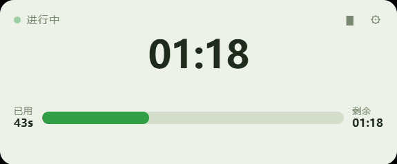
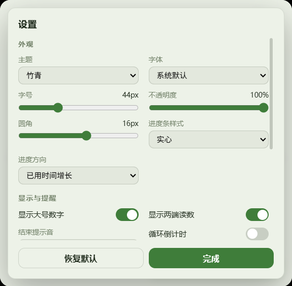

# 倒计时 · Countdown

<p align="center">
  
  
</p>

<p align="center">
  一个轻量的 Windows 桌面倒计时挂件。可以塞进屏幕边缘当细条用，也可以当成正常面板摆在桌面上。
</p>

<p align="center">
  
  
  
  
  
  
</p>

---

## 这是什么

一个**始终在后台走秒**的倒计时挂件：

- 平时是一块小面板，设定时长、开跑、看着进度条一点点填满；
- 不想占地方？切成 **8 mm 宽的无边框竖条**，直接吸在屏幕右边缘，贯穿整个屏幕高度；
- 到点了窗口**红色闪烁**提醒你，点一下就停；
- 把它**缩到托盘**继续在后台计时，右键托盘图标随时叫回来。

<p align="center">
  
</p>

## 功能

### 计时

| 能力 | 说明 |
| --- | --- |
| 设定时间 | 时 / 分 / 秒输入，外加 9 个快捷档位（1m / 3m / 5m / 10m / 15m / 25m / 45m / 1h / 1.5h） |
| 进度条 | 两端分别是**已用**和**剩余**；条体随进度实时增长 |
| 时间格式 | < 60s 显示 `42s`，≥ 60s 显示 `05:30`，≥ 1h 显示 `01:05:30` |
| 循环倒计时 | 到点自动进入下一轮，并在界面上提示当前是第几轮 |
| 结束提醒 | 窗口持续**红色闪烁**（细条模式同样闪烁）+ 提示音（钟声 / 滴声 / 静音），可随时「停止闪烁」 |
| 后台精确 | 计时跑在 Rust 线程里，窗口缩到托盘也照样走秒 |

### 外观

| 能力 | 说明 |
| --- | --- |
| 主题 | 6 套配色：墨水屏 / 夜幕 / 霓虹 / 竹青 / 琥珀 / 黑白 |
| 字体 | 5 种：系统默认 / 等宽 / 衬线 / 圆体 / 窄体 |
| 进度条样式 | 实心 / 渐变 / 分段 / 辉光 |
| 进度条粗细 | 按屏幕百分比设置，竖排按屏幕宽度算、横排按屏幕高度算，一个数值同时控制两个方向 |
| 进度条圆角 | 0–100px 可调，超过条粗一半就是胶囊形 |
| 进度方向 | 「已用时间增长」或「剩余时间递减」 |
| 其它 | 字号、窗口不透明度、圆角、两端读数、置顶、边缘自动吸附 |
| 计时配色 | 进行中**绿色**，暂停变暗，到点转红 |

### 窗口

| 能力 | 说明 |
| --- | --- |
| 自适应布局 | 宽 > 高走横向进度条，高 > 宽走纵向进度条，窄到一定程度直接变成细条 |
| 自由缩放 | 拖动窗口左右边缘即可缩放，最窄 **8 mm** |
| 细条模式 | 一键切成贯穿整屏高度、吸在屏幕右侧的竖条 |
| 边缘吸附 | 拖到屏幕边缘自动贴边（可在设置里关掉） |
| 细条停靠侧 | 细条模式吸在屏幕右侧或左侧，可在设置里切换（默认右侧） |
| 设置面板 | 打开时窗口自动放大并留在屏幕内，标题可拖动；关闭后回到原来的位置和大小 |
| 操作说明 | 顶栏 `?` 或右键菜单打开，内容内置在程序里，单个 exe 即可使用 |
| 常驻托盘 | 关窗口 ≠ 退出程序，只有点托盘菜单的「退出程序」才真正结束进程 |

### 操作

| 入口 | 能做什么 |
| --- | --- |
| 右键窗口 | 设定时间、开始、暂停 / 继续、停止（带确认）、重置、停止闪烁、窗口置顶、细条模式、靠边吸附、窗口居中、设置、关闭窗口、退出程序 |
| 顶栏图标 | ▮ 切细条模式、图钉切换窗口置顶、⚙ 打开设置、? 打开操作说明 |
| 全局热键 | `Win+↑` 开始 / 继续、`Win+↓` 暂停、`Win+←` 停止、`Win+→` 重置（可在设置里改键或关闭） |
| 窗口内快捷键 | `空格` 暂停 / 继续、`Enter` 设定时间、`R` 重置、`Esc` 关闭面板 |
| 进度条 | 单击暂停 / 继续，双击重置 |
| 托盘图标 | 左键显示 / 隐藏窗口，右键打开菜单 |

## 界面布局规则

程序会根据窗口当前尺寸自动切换三套布局：

```text
横宽 m > n             竖长 m < n              极窄（< 90px）
┌──────────────┐      ┌────────┐              ┌─┐
│    24:48     │      │  24:48 │              │▓│
│ 已用 ▓▓▓░░ 剩余│      │  已用  │              │▓│  ← 8mm 细条
└──────────────┘      │ ▓▓▓░░  │              │░│
                       │  ░░░░  │              │░│
                       │  剩余  │              └─┘
                       └────────┘
```

- 纵向布局下进度条**自下而上**增长，跟 Windows 任务栏的进度显示一个方向。
- 纵向时读数竖排显示，避免在 8mm 宽度里被挤变形。

## 全局热键

| 组合键 | 作用 |
| --- | --- |
| `Win + ↑` | 开始 / 继续 |
| `Win + ↓` | 暂停 |
| `Win + ←` | 停止（弹确认框） |
| `Win + →` | 重置 |

> **关于热键冲突**：Windows 自己占用了 `Win + 方向键` 的窗口贴靠功能，所以这组键在部分系统上注册不下来。
> 程序检测到注册失败时会**自动回退到 `Ctrl + Alt + 方向键`**，并在窗口右下角提示实际生效的组合键。
> 想彻底不占用，可以在「设置 → 全局快捷键」里改键或直接关掉。

## 使用

1. 右键窗口 → **设定时间…**，选好时长点 **开始**；
2. 想要小一点：拖动窗口**左边缘**往右收，窄到 8mm 会自动切成竖向细条；
   或者右键 → **细条模式**，一步到位变成贯穿整屏的竖条；
3. 想固定在屏幕边上：右键 → **靠边吸附**（吸哪一侧跟着设置里的「细条停靠侧」走）；
4. 开始倒计时后底部的「设定时间 / 开始」按钮会自动隐藏，右键菜单照常可用；
5. 到点窗口红色闪烁，点窗口里的 **停止闪烁**（或右键同项）即可止闪；
6. 关窗口只是隐藏，右键**托盘图标 → 退出程序**才真正退出。

## 从源码构建

### 环境要求

| 依赖 | 版本 |
| --- | --- |
| Node.js | 20.19+ 或 22.12+（Vite 7 的硬性要求） |
| Rust | 1.77+（推荐 stable 最新） |
| Windows | [Microsoft C++ Build Tools]（勾选「使用 C++ 的桌面开发」）+ WebView2 运行时 |

### 命令

```bash
npm install            # 安装前端依赖
npm run tauri dev      # 开发模式（带热更新）
npm run build          # 只构建前端（tsc + vite）
```

### 打包

```bash
# 默认产出 NSIS 安装包
npm run tauri build

# 同时产出 NSIS 与 MSI
npm run tauri build -- --bundles nsis,msi
```

产物位置：

```text
src-tauri/target/release/countdown.exe                            免安装版，双击即用
src-tauri/target/release/bundle/nsis/Countdown_0.1.0_x64-setup.exe   NSIS 安装包
src-tauri/target/release/bundle/msi/Countdown_0.1.0_x64_en-US.msi    MSI 安装包
```

> **提示**：首次打包时 Tauri 会自动下载 NSIS / WiX 工具链，国内网络下可能比较慢甚至超时；
> 这只影响打包阶段，不影响已经生成好的可执行文件。工具链缓存在
> `%LOCALAPPDATA%\tauri\`，成功后就不会再下了。

> `src-tauri/target/` 是纯编译缓存（完整构建约 8~9 GB），随时可以删，下次构建自动重建。
> 想让项目目录保持干净，可以把它加进 `.gitignore`（默认已经加好了）。

### 目录结构

```text
├── index.html                  前端骨架（面板 / 设定 / 设置 / 确认 / 右键菜单）
├── docs/                       README 用到的截图
├── src/
│   ├── main.ts                 应用逻辑：状态渲染、右键菜单、快捷键、托盘联动
│   ├── settings.ts             设置面板（外观 / 显示 / 热键）
│   ├── format.ts               时间格式化（s / mm:ss / hh:mm:ss）
│   ├── sound.ts                WebAudio 提示音
│   ├── types.ts                类型定义与默认值
│   └── styles.css              主题变量、三套自适应布局、闪烁动画
├── scripts/
│   ├── make-icon.mjs           生成 1024×1024 图标源图
│   ├── screenshot.ps1          截取应用窗口（调试用）
│   ├── drive.ps1               模拟按键 / 点击，驱动窗口做自动化验证
│   └── windows.ps1             列出应用的所有窗口句柄与位置
└── src-tauri/
    ├── src/
    │   ├── main.rs             入口
    │   ├── lib.rs              命令注册、事件、后台计时线程
    │   ├── timer.rs            倒计时状态机
    │   ├── settings.rs         设置持久化
    │   ├── hotkeys.rs          全局热键注册（占用时自动回退 Ctrl+Alt）
    │   ├── tray.rs             托盘图标与菜单
    │   └── window_ops.rs       贴边吸附、8mm 细条、窗口尺寸
    ├── capabilities/           Tauri 权限声明
    ├── icons/                  应用图标
    └── tauri.conf.json         Tauri 配置（无边框 / 透明窗口）
```

### 图标

```bash
node scripts/make-icon.mjs
npx tauri icon scripts/icon-source.png
```

## 配置存放位置

所有设置（主题、字号、热键、默认时长……）保存在：

```text
%APPDATA%\com.countdown.desktop\settings.json
```

删掉这个文件即可恢复默认设置。

## 常见问题

**Q：点右上角关闭按钮，程序还在后台跑？**
这是设计如此。关窗口只是隐藏，计时继续；想真正退出请用托盘菜单的「退出程序」。

**Q：`Win + 方向键` 没反应？**
多半是被系统或别的软件占用了。程序会自动回退到 `Ctrl + Alt + 方向键`，生效的组合会提示在窗口右下角。

**Q：细条太窄了 / 太宽了？**
宽度固定为 8mm（约 30 逻辑像素），这是为了在屏幕上尽量不碍事。觉得不合适可以在 `src-tauri/src/window_ops.rs` 里改 `BAR_WIDTH_MM`。

**Q：想让它开机就自动启动？**
目前需要手动把程序加到 Windows 启动项里。

## 参与贡献

欢迎提 Issue 和 PR：

- 修 bug、补功能、加主题 / 音效都可以；
- 改动涉及 Rust 侧的话，跑一遍 `cargo clippy` 和 `cargo fmt`；
- 涉及界面的改动，附一张截图会更友好。

## License

[MIT](LICENSE)

[Microsoft C++ Build Tools]: https://visualstudio.microsoft.com/downloads/
